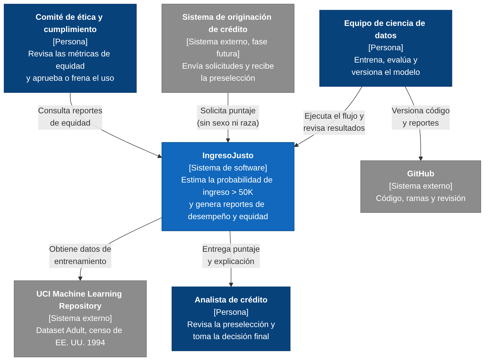
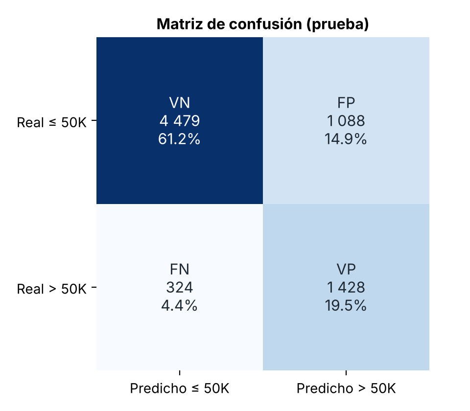
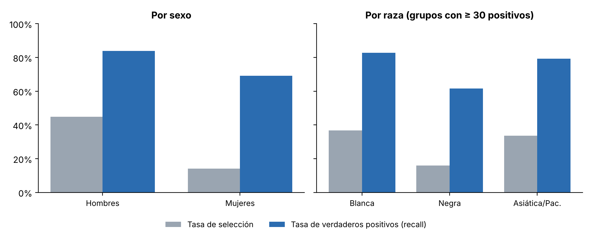

# IngresoJusto: preselección de crédito con un modelo explicable y auditado

Mini-proyecto final de Ingeniería de Software (Universidad de La Salle). Un modelo de Machine
Learning estima si una persona gana más de 50 000 USD al año, se evalúa con métricas cuantitativas
y se somete a una auditoría ética sobre sus sesgos, riesgos y límites de uso.

| Integrante | Correo institucional | Rama individual |
|---|---|---|
| Andrés Felipe Riaño Moreno | ariano87@unisalle.edu.co | `dev_ariano87` |
| [Integrante 2] | [usuario]@unisalle.edu.co | `dev_[usuario]` |
| [Integrante 3] | [usuario]@unisalle.edu.co | `dev_[usuario]` |

Cada integrante trabaja solo en su rama `dev_<usuario del correo>`. El proyecto se consolida en
**`develop`**, que es la rama de entrega y de revisión.

---

## 1. Problema

Una fintech quiere enviar ofertas de tarjeta de crédito solo a personas con ingresos suficientes,
pero en la solicitud inicial no pide soportes de ingreso. La pregunta del proyecto es doble:

1. **Técnica:** ¿se puede estimar, a partir de datos demográficos y laborales, si una persona gana
   más de 50 000 USD al año, mejor que una regla trivial?
2. **Ética:** ¿el modelo trata de forma equivalente a mujeres y hombres, y a personas de distintos
   grupos raciales? ¿Bajo qué condiciones sería responsable usarlo?

## 2. Datos

Se usa el dataset **Adult** del UCI Machine Learning Repository (Becker y Kohavi, 1996), un extracto
del censo de EE. UU. de 1994 con licencia CC BY 4.0. Detalle de columnas, fuente y suma de
verificación en [`data/README.md`](data/README.md).

| Dato | Valor |
|---|---|
| Filas | 48 842 (48 790 tras quitar 52 duplicados exactos) |
| Variables | 14 más el objetivo `income` |
| Clase positiva (`>50K`) | 23,9 % (dataset desbalanceado) |
| Faltantes | `workclass` 2 795 · `occupation` 2 805 · `native_country` 856 |
| Composición por sexo | 66,8 % hombres · 33,2 % mujeres |
| Ingreso > 50K por sexo | hombres 30,4 % · mujeres 10,9 % |
| Composición por raza | blanca 85,5 % · negra 9,6 % · asiática o de islas del Pacífico 3,1 % · amerindia 1,0 % · otra 0,8 % |

**Variables del modelo:** edad, años de educación, horas por semana, ganancia y pérdida de capital,
tipo de empleador, estado civil, ocupación y rol en el hogar. **Excluidas:** `sex`, `race` y
`native_country` (atributos sensibles que solo se usan para auditar), `fnlwgt` (peso muestral) y
`education` (redundante).

## 3. Cómo funciona la solución

```mermaid
flowchart LR
    A[Datos crudos<br/>adult.csv] --> B[Limpieza<br/>duplicados y faltantes]
    B --> C[Partición estratificada<br/>70 / 15 / 15]
    C --> D[Preprocesamiento<br/>imputar · log1p · escalar · one-hot]
    D --> E[Selección de modelo<br/>CV de 5 pliegues]
    E --> F[Regresión logística<br/>C elegido por CV]
    F --> G[Umbral<br/>máx. F1 en validación]
    G --> H[Evaluación en prueba<br/>una sola vez]
    H --> I[Auditoría de equidad<br/>sexo y raza]
    I --> J[Reportes y modelo<br/>reports/ · models/]
```



| Etapa | Código | Evidencia |
|---|---|---|
| Carga, limpieza y partición | [`src/data.py`](src/data.py) | `reports/metrics.json` (`dataset`, `particion`) |
| Preprocesamiento | [`src/features.py`](src/features.py) | Pipeline de scikit-learn |
| Comparación de candidatos, entrenamiento y umbral | [`src/train.py`](src/train.py) | `reports/comparacion_modelos.csv`, `reports/figures/02_umbral.png` |
| Métricas y matriz de confusión | [`src/evaluate.py`](src/evaluate.py) | `reports/figures/03_matriz_confusion.png`, `04_roc.png` |
| Auditoría de equidad | [`src/fairness.py`](src/fairness.py) | `reports/equidad_sexo.csv`, `equidad_raza.csv`, `06_equidad.png` |
| Flujo completo | [`src/run_all.py`](src/run_all.py) | `models/modelo_logistico.joblib` |
| Recorrido narrado | [`notebooks/01_flujo_ml_ingreso_justo.ipynb`](notebooks/01_flujo_ml_ingreso_justo.ipynb) | Notebook ejecutado, con salidas |

### Cómo demostramos que los resultados son válidos

- **Sin fuga de información:** se quitan los duplicados antes de partir; imputación, escalado y
  codificación se ajustan solo con entrenamiento; el umbral se elige en validación; prueba se usa
  una sola vez. Las pruebas automáticas verifican que los tres conjuntos no comparten filas.
- **Comparación con una línea base:** el modelo debe superar a un clasificador que siempre predice la
  clase mayoritaria.
- **Validación cruzada** de 5 pliegues para comparar candidatos y elegir hiperparámetros.
- **Reproducibilidad:** semilla fija y una prueba que entrena dos veces y exige resultados idénticos.
- **Criterios de aceptación** codificados como pruebas (`pytest`), descritos en la sección 7.

## 4. Alcance

| El sistema hará | El sistema no hará |
|---|---|
| Estimar la probabilidad de que una persona gane más de 50 000 USD al año | Aprobar ni rechazar créditos de forma automática |
| Explicar qué variables pesan en cada estimación (coeficientes) | Usar sexo, raza o país de origen como entradas |
| Reportar métricas de desempeño y de equidad por grupo | Garantizar validez para la población colombiana actual (los datos son de EE. UU., 1994) |
| Correr de forma reproducible, local y por lotes | Exponer una API pública ni almacenar datos de solicitantes reales |

## 5. Diagrama C4 de contexto



Fuente editable: [`docs/c4-contexto.mmd`](docs/c4-contexto.mmd). El sistema de originación es un
consumidor previsto para una fase futura; hoy el sistema corre por lotes y su salida la revisa una persona.

## 6. Decisiones de arquitectura (ADR)

| ADR | Decisión | Motivo principal |
|---|---|---|
| [ADR-001](docs/adr/ADR-001-enfoque-de-implementacion.md) | Pipeline modular en Python (`src/`), notebook que lo narra y pruebas con `pytest` | Reproducible, verificable por etapas y revisable en Git |
| [ADR-002](docs/adr/ADR-002-seleccion-del-modelo.md) | Regresión logística sin atributos protegidos, umbral elegido en validación | Desempeño equivalente a árbol y KNN, pero interpretable y sin guardar datos personales para predecir |
| [ADR-003](docs/adr/ADR-003-almacenamiento-y-despliegue.md) | Datos y modelo versionados en el repositorio; ejecución local por lotes, sin API | Reproducibilidad total; una API sería prematura mientras el modelo no cumpla los criterios éticos |

## 7. Calidad y evaluación del modelo

### Estrategia de separación de datos

Partición estratificada con semilla 42: **70 % entrenamiento** (34 152), **15 % validación** (7 319)
y **15 % prueba** (7 319). Las tres conservan la misma proporción de positivos (23,9 %).

### Métricas en el conjunto de prueba

| Métrica | Regresión logística (umbral 0,26) | Misma, con umbral 0,5 | Línea base | Qué significa |
|---|---|---|---|---|
| Accuracy | 0,807 | 0,849 | 0,761 | Proporción total de aciertos. Engaña con clases desbalanceadas: la línea base logra 76 % sin detectar a nadie |
| Precision | 0,568 | 0,723 | 0,000 | De cada 100 personas que el modelo marca como ingreso alto, 57 lo tienen |
| Recall | 0,815 | 0,597 | 0,000 | De cada 100 personas con ingreso alto, el modelo detecta 82 |
| F1 | 0,669 | 0,654 | 0,000 | Equilibrio entre precision y recall |
| ROC-AUC | 0,902 | 0,902 | 0,500 | Probabilidad de ordenar a una persona de ingreso alto por encima de una de ingreso bajo |

El umbral 0,26 maximiza F1 en validación: privilegia no dejar por fuera a personas que sí califican
(recall) a costa de más falsos positivos. Si para la fintech fuera más costoso ofrecer crédito a
quien no puede pagarlo, convendría subir el umbral y ganar precision.

### Matriz de confusión (prueba)



| Celda | Cantidad | Significado en este caso |
|---|---|---|
| Verdaderos positivos (VP) | 1 428 | Personas con ingreso alto correctamente preseleccionadas |
| Falsos positivos (FP) | 1 088 | Personas con ingreso bajo a quienes se les ofrecería crédito: riesgo de sobreendeudamiento |
| Verdaderos negativos (VN) | 4 479 | Personas con ingreso bajo correctamente descartadas |
| Falsos negativos (FN) | 324 | Personas con ingreso alto que pierden la oferta aunque califican: oportunidad negada |

### Comparación con el modelo de referencia

La línea base (siempre "≤ 50K") obtiene 76,1 % de accuracy, pero F1 de 0 porque no detecta a nadie.
El modelo sube F1 a 0,669 y ROC-AUC de 0,5 a 0,902. En validación cruzada la regresión logística
quedó a menos de 0,02 de F1 del árbol y de KNN (ver [ADR-002](docs/adr/ADR-002-seleccion-del-modelo.md)).

### Criterios de aceptación del software

| ID | Criterio | Umbral | Resultado | Estado |
|---|---|---|---|---|
| AC1 | F1 en prueba | ≥ 0,65 | 0,669 | Cumple |
| AC2 | ROC-AUC en prueba | ≥ 0,85 | 0,902 | Cumple |
| AC3 | Mejora de F1 sobre la línea base | ≥ 0,30 | +0,669 | Cumple |
| AC4 | Diferencia de recall entre sexos (igualdad de oportunidades) | ≤ 0,10 | 0,147 | **No cumple** |
| AC5 | Razón de impacto dispar entre sexos (regla de los cuatro quintos) | ≥ 0,80 | 0,315 | **No cumple** |
| AC6 | Reproducibilidad con la misma semilla | Idéntico | Idéntico | Cumple |
| AC7 | Sin filas compartidas entre entrenamiento, validación y prueba | 0 | 0 | Cumple |

**Veredicto:** el modelo se acepta como **prototipo de apoyo a la decisión humana**, no como sistema
de decisión automática, porque no cumple los criterios éticos AC4 y AC5. Las pruebas de AC4 y AC5 están
marcadas como fallo esperado (`xfail` estricto): si un cambio futuro las hace pasar, `pytest` avisa
para actualizar esta conclusión.

## 8. Análisis ético

| Grupo | Tasa real de ingreso alto | Tasa de selección del modelo | Recall | Falsos positivos |
|---|---|---|---|---|
| Hombres | 30,5 % | 44,8 % | 83,9 % | 27,7 % |
| Mujeres | 11,3 % | 14,1 % | 69,1 % | 7,1 % |
| Raza blanca | 25,5 % | 36,8 % | 82,8 % | 21,0 % |
| Raza negra | 12,5 % | 16,0 % | 61,6 % | 9,5 % |
| Asiática o de islas del Pacífico | 22,8 % | 33,6 % | 79,2 % | 20,1 % |



- **Sesgo histórico en los datos.** En 1994 la proporción de hombres con ingreso alto casi triplicaba
  la de mujeres. El modelo aprende esa realidad y la proyecta hacia el futuro.
- **Brecha de oportunidad.** Una mujer que sí gana más de 50 000 USD tiene un 31 % de probabilidad de
  quedar por fuera, frente a un 16 % de un hombre en la misma situación. Entre personas de raza negra
  y blanca la brecha de recall es de 21 puntos.
- **Quitar el atributo no basta.** El modelo no ve el sexo, pero `relationship` lo revela: "Husband"
  corresponde a un hombre en el 99,99 % de los casos y "Wife" a una mujer en el 99,87 %. Si se
  incluyen sexo y raza como entradas, la brecha de recall entre sexos sube de 0,15 a 0,23.
- **Representación insuficiente.** Las personas amerindias (71 en prueba) y de "otra" raza (63) no
  tienen suficientes casos positivos para conclusiones confiables, así que no se evalúan.
- **Privacidad.** El dataset es anónimo, pero edad, ocupación, raza y país de origen combinados
  pueden reidentificar a personas de grupos pequeños. En Colombia, el origen racial o étnico es un
  dato sensible según la Ley 1581 de 2012, y el uso de información para decisiones de crédito está
  regulado por la Ley 1266 de 2008.
- **Vigencia y contexto.** Datos de EE. UU. de hace más de 30 años, con un umbral nominal de
  50 000 USD sin ajustar por inflación: no representan a la población colombiana actual.
- **Transparencia.** La regresión logística permite explicar a cada solicitante qué variables
  pesaron en su resultado; un modelo de caja negra no lo permitiría.

El análisis completo, con impacto social y recomendaciones, está en
[`docs/Informe_IngresoJusto.pdf`](docs/Informe_IngresoJusto.pdf).

## 9. Riesgos técnicos

| Riesgo | Impacto | Mitigación |
|---|---|---|
| **Sesgos** en los datos y variables proxy del sexo | Alto: discriminación indirecta contra mujeres y personas de raza negra | Excluir atributos protegidos, auditar por grupo en cada versión (AC4, AC5) y exigir revisión humana |
| **Fuga de información** entre conjuntos | Alto: métricas infladas que no se repiten en producción | Quitar duplicados antes de partir, preprocesar dentro del Pipeline, elegir el umbral en validación y probar la disyunción de conjuntos |
| **Sobreajuste** | Medio: el modelo memoriza el entrenamiento | Regularización L2 con C por validación cruzada; validación (0,891) y prueba (0,902) dan ROC-AUC similares |
| **Datos insuficientes o desactualizados** | Alto: grupos pequeños sin evaluar y población de 1994 | Reportar solo grupos con ≥ 30 positivos; reentrenar con datos locales y recientes antes de cualquier uso real |
| **Limitaciones de cómputo** | Bajo: KNN y una búsqueda amplia de hiperparámetros son lentos en equipos personales | Modelo lineal liviano (el flujo completo tarda cerca de un minuto en un portátil); rejilla de hiperparámetros pequeña |

## 10. Conclusiones y recomendaciones

**Conclusiones técnicas.** La regresión logística supera ampliamente la línea base (F1 0,669 frente
a 0; ROC-AUC 0,902) y cumple los criterios técnicos. Con un umbral de 0,26 detecta el 82 % de las
personas con ingreso alto, a cambio de que 43 de cada 100 preseleccionadas no lo tengan.

**Recomendaciones.**

1. Usar el modelo solo como apoyo: un analista revisa los casos, en especial los rechazados.
2. Mitigar la brecha con técnicas de equidad (repesado de muestras o umbrales que igualen el recall,
   por ejemplo con Fairlearn) y volver a medir AC4 y AC5.
3. Reentrenar con datos colombianos recientes, con consentimiento y bajo la Ley 1581 de 2012.
4. Revisar las variables proxy (`relationship`, `marital_status`) y medir el efecto de quitarlas.
5. Acordar con el negocio el costo de cada error para fijar el umbral, en lugar de solo maximizar F1.

## 11. Cómo ejecutar

```bash
python -m venv .venv
source .venv/bin/activate          # en Windows: .venv\Scripts\activate
pip install -r requirements.txt

python -m src.run_all              # flujo completo: reports/ y models/
pytest -v                          # criterios de aceptación
jupyter notebook notebooks/01_flujo_ml_ingreso_justo.ipynb
```

## 12. Estructura del repositorio

```
├── data/              dataset original y su descripción
├── docs/              ADR, diagrama C4 e informe en PDF
├── models/            modelo entrenado (joblib)
├── notebooks/         recorrido del flujo, ejecutado
├── reports/           métricas (JSON, CSV) y figuras
├── src/               código del flujo, un módulo por etapa
├── tests/             pruebas de datos y criterios de aceptación
└── requirements.txt
```

## 13. Glosario

| Término | Definición |
|---|---|
| Accuracy | Proporción de predicciones correctas sobre el total |
| ADR | *Architecture Decision Record*: documento corto que registra una decisión, su contexto y sus consecuencias |
| Atributo protegido | Característica que no debe motivar un trato distinto (sexo, raza, origen nacional) |
| C4 | Modelo de diagramas de arquitectura en cuatro niveles; el de contexto muestra el sistema, sus usuarios y sistemas externos |
| F1 | Media armónica de precision y recall |
| Falso negativo / falso positivo | Caso positivo que el modelo no detecta / caso negativo que el modelo marca como positivo |
| Fuga de información | Uso, durante el entrenamiento, de información que no estaría disponible al predecir |
| Igualdad de oportunidades | Criterio de equidad que exige el mismo recall en todos los grupos |
| Impacto dispar (razón) | Tasa de selección del grupo menos favorecido dividida por la del más favorecido; bajo 0,8 incumple la regla de los cuatro quintos |
| Línea base | Modelo trivial de referencia (aquí, predecir siempre la clase mayoritaria) |
| Precision | De los casos marcados como positivos, proporción que lo es realmente |
| Recall | De los casos positivos reales, proporción que el modelo detecta |
| Regresión logística | Modelo lineal que estima la probabilidad de la clase positiva |
| ROC-AUC | Área bajo la curva ROC: capacidad del modelo para ordenar positivos por encima de negativos |
| Sobreajuste | Cuando el modelo aprende detalles del entrenamiento que no generalizan |
| Umbral de decisión | Probabilidad a partir de la cual el modelo predice la clase positiva |
| Variable proxy | Variable permitida que revela indirectamente un atributo protegido |

## 14. Referencias

- Barocas, S., Hardt, M. y Narayanan, A. (2023). *Fairness and machine learning: Limitations and opportunities*. MIT Press. https://fairmlbook.org
- Becker, B. y Kohavi, R. (1996). *Adult* [Dataset]. UCI Machine Learning Repository. https://doi.org/10.24432/C5XW20
- Brown, S. (s. f.). *The C4 model for visualising software architecture*. https://c4model.com
- Congreso de Colombia. (2008). *Ley 1266 de 2008*, disposiciones generales del hábeas data y manejo de la información financiera.
- Congreso de Colombia. (2012). *Ley Estatutaria 1581 de 2012*, disposiciones generales para la protección de datos personales.
- Hardt, M., Price, E. y Srebro, N. (2016). Equality of opportunity in supervised learning. *Advances in Neural Information Processing Systems, 29*.
- Mitchell, M., Wu, S., Zaldivar, A., Barnes, P., Vasserman, L., Hutchinson, B., Spitzer, E., Raji, I. D. y Gebru, T. (2019). Model cards for model reporting. *Proceedings of the Conference on Fairness, Accountability, and Transparency*, 220–229.
- Nygard, M. (2011). *Documenting architecture decisions*. https://cognitect.com/blog/2011/11/15/documenting-architecture-decisions
- Pedregosa, F. et al. (2011). Scikit-learn: Machine learning in Python. *Journal of Machine Learning Research, 12*, 2825–2830.
- UNESCO. (2021). *Recomendación sobre la ética de la inteligencia artificial*.
